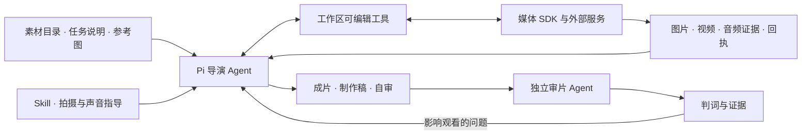

# Interactive Video Studio

把**素材、故事要求和参考图**交给一个自主导演 Agent，让它完成改编、分镜、媒体生成、检查、配乐和剪辑，再由独立审片 Agent 检查成片。

项目支持探险 Vlog、恋综和悬疑互动短剧。导演基于 Pi 的原生 `read / write / edit / bash` 工作，可以修改自己工作区的工具脚本，自主选择镜头组织和修复办法；程序负责模型接入、任务回执、会话恢复与预算。剧情能改多少、用什么模型和视角，由本次任务说明确定。

## 结构与职责



上图表示组件关系。剧本、拍摄、检查和剪辑的具体顺序由导演决定；独立审片使用成片和原始基准，不读取导演自审来代替判断。

| 组件 | 职责 | 主要位置 |
|---|---|---|
| 导演运行器 | 初始化工作区、启动 Pi、恢复会话、限制请求与运行时间 | [`starter.py`](examples/pi-video-agent/starter.py) |
| 导演工具包 | 生图、生视频、取证、转录、配乐、剪辑和交付记录；复制到每个任务后可独立修改 | [`template/`](examples/pi-video-agent/template/) |
| 创作 Skill | 剧情因果、对白、审美构图、空间与连续性、镜头和声音；含参考影片经验 | [`skills/episode-production/`](skills/episode-production/)、[`skill-extra/`](examples/pi-video-agent/template/skill-extra/) |
| 媒体 SDK | 对接云端与本地模型，保存实际请求、附件、任务 ID 和结果 | [`providers/`](src/novel_manga/providers/) |
| 独立审片 | 判断观看问题，输出 `accepted / rejected / incomplete` 和可定位的证据 | [`REVIEWER-SYSTEM.md`](examples/pi-video-agent/template/REVIEWER-SYSTEM.md)、[`reviewer-skill/`](examples/pi-video-agent/template/reviewer-skill/) |
| 批次协调器 | 并行运行已准备的多集任务、补审成片、将阻塞问题交原导演修复并复审 | [`pi_episode_lanes.py`](scripts/pi_episode_lanes.py)、[`pi_episode_review.py`](scripts/pi_episode_review.py) |

## 能做什么

- **创作与改编**：从原始素材和任务要求设计故事、分镜及互动结尾；支持授权范围内的大幅改写。
- **三种视角**：全程第一视角、混合视角，或导演自行选择。
- **多种生成路线**：GPT Image 2 生图；SD2.0 Fast / Mini、MiniMax-H3 本地或云端、FastH3-Omni 生视频。
- **参考素材接入**：人物、服装、场景图片和音色参考实际传入模型；首帧按所选路线使用，保留附件与请求证据。
- **声音检查与配乐**：Eureka 音频感知、SenseVoice 转录；检索已有本地曲库，由导演取得声音证据后选曲、混音并保留来源署名。
- **后期与互动页**：FFmpeg 裁切、缩放、字幕、帧级音画对齐、合成缓存、追加三秒 A/B/C 选项页；单改 BGM 可复制视频流，保留原片。
- **独立审片与回修**：影响观看的问题回到原导演会话；轻微问题写建议。修复导出重新审片，判词绑定实际视频版本。
- **并行与恢复**：多集独立会话和预算、已受理任务继续查询下载、原会话续接、经授权的一次性修复加时。

## 仓库目录

```text
interactive-video/                   # 本 Git 仓库
├── scripts/
│   ├── pi_video_agent.py            # 对外 CLI：init / run / batch
│   ├── pi_episode_lanes.py          # 已准备批次的制作与审片调度
│   └── pi_episode_review.py         # 审片结果校验与原导演回修
├── examples/pi-video-agent/
│   ├── starter.py                  # CLI 的实际实现
│   └── template/
│       ├── SYSTEM.md / SKILL.md     # 导演说明
│       ├── REVIEWER-SYSTEM.md       # 独立审片说明
│       ├── reviewer-skill/          # 审片 Skill
│       ├── skill-extra/             # 导演补充参考
│       └── tools/                   # Pi 运行器及可编辑媒体/后期工具
├── skills/                         # 共用创作、H3 提示词与修复指导
├── src/novel_manga/
│   ├── providers/                  # 模型与媒体服务适配
│   ├── llm/                        # LLM 端点、资源与额度配置
│   └── application/                # 音乐等共用能力及保留的历史宿主
├── configs/                        # 服务、模型池、资源与项目配置
├── projects/                       # adventure / romance / suspense 内容资料
├── tests/                          # 接口、回执、恢复、审核与后期回归
└── docs/                           # 详细使用说明和历史记录
```

Python 包名沿用 `novel_manga`。当前新任务通过 Pi 入口运行；旧宿主保留用于历史任务恢复。

部署时，代码与媒体分开存放。本机统一目录采用以下布局，`media/`、`runtime/` 和 `archive/` 不随代码上传：

```text
interactive-video/
├── repo/                           # Git 共享对象库与原工作面
├── worktrees/main/                 # 当前维护主线
├── worktrees/<开发任务>/            # 独立开发分支
├── runtime/                        # Python、Pi、音频等本地环境
├── media/
│   ├── inputs/                     # 原始素材
│   ├── runs/                       # 完整任务包与运行历史
│   ├── deliveries/                 # 交付视频及记录
│   └── research/                   # 参考影片与实验资料
└── archive/                        # 历史工作树与备份
```

## 接口与使用

对外入口是 **Python CLI + JSON 文件**。Pi 通过工作区工具调用媒体 SDK；模型服务部署在本地 GPU 或外部平台。

### 1. 准备环境和输入

| 依赖 | 用途 |
|---|---|
| Python ≥ 3.11，本项目 Python 依赖 | 运行 CLI 和 SDK；依赖声明在 [`pyproject.toml`](pyproject.toml) |
| Bun | `run` 用它启动原生 Pi Agent |
| 已有 Pi `node_modules` | 包含 `@earendil-works/pi-coding-agent`、`@earendil-works/pi-ai`，通过 `--dependencies` 显式指定 |
| FFmpeg / FFprobe | 剪辑、合成、抽帧与技术检查 |
| 可用的 LLM 和媒体服务 | 按选定路线配置凭据、H3 模型池或 FastH3 服务 |
| 可选的 Eureka、SenseVoice、曲库环境 | 音频感知、转录与配乐；模型和曲库另行配置 |

在项目独立 Python 环境中安装仓库依赖：

```bash
python -m pip install -e '.[dev]'
```

这一步安装本仓库的 Python 依赖。Pi 依赖、模型权重、音频环境和音乐文件由部署环境提供。

`--input` 接受**资料目录**：剧本、人物/场景说明、参考图、可选音频等。ZIP 素材先保留原包，再解压到资料目录。另准备一份 `TASK.md`，写明本次目标、可改编范围、时长/画幅、受保护事实和交付要求。

### 2. 初始化并启动一集

以下命令在仓库根目录执行；`python` 应来自项目环境：

```bash
export IVS_SDK_ROOT="$PWD"
export IVS_PI_DEPS="/absolute/path/to/pi/node_modules"
export IVS_RUN="/absolute/path/to/media/runs/demo-episode"

python scripts/pi_video_agent.py init "$IVS_RUN" \
  --sdk-root "$IVS_SDK_ROOT" \
  --dependencies "$IVS_PI_DEPS" \
  --input /absolute/path/to/material \
  --task-file /absolute/path/to/TASK.md \
  --lane MiniMax-H3 --h3-mode local \
  --first-frame selective --viewpoint mixed --interaction-page none

python scripts/pi_video_agent.py run "$IVS_RUN" --endpoint official-ds41
```

`init` 复制输入、完整 Skill 和工具，写入配置与任务说明；不会生成媒体。`run` 才启动导演 Agent 并调用所配置的模型。

LLM 可通过 `--endpoint` 选择项目已有预设，见 [`llm/config.py`](src/novel_manga/llm/config.py) 和 [`model-resources.json`](configs/model-resources.json)；也可在不传 `--endpoint` 时使用 `PI_PROBE_BASE`、`PI_PROBE_MODEL`、`PI_PROBE_API_KEY`。凭据由环境或本机 `.env` 提供。

常用初始化选项：

| 参数 | 取值 / 默认值 | 作用 |
|---|---|---|
| `--lane` | `sd2.0-fast` / `sd2.0-mini` / `MiniMax-H3` / `FastH3-Omni`；默认未锁定 | 选择视频路线 |
| `--h3-mode` | `local` / `cloud`；默认 `local` | MiniMax-H3 的本地池或云端路线 |
| `--first-frame` | `none` / `selective` / `required`；默认 `selective` | 禁用、导演按需使用、每次视频请求要求首帧 |
| `--viewpoint` | `first-person` / `mixed` / `auto`；默认 `auto` | 全程第一视角、混合视角、导演自定 |
| `--interaction-page` | `required` / `none`；默认 `required` | 是否要求三秒 A/B/C 尾页；选项内容应随任务提供 |
| `--wall-seconds` | 默认 `14400` | 该任务的运行时间上限 |
| `--max-model-requests` | 默认 `256` | 该任务的 LLM 请求上限 |
| `--skills` | 默认仓库 `skills/episode-production` | 指定完整共用 Skill 目录 |
| `--asset-cache` | 可选目录 | 显式复用同系列参考资产 |
| `--previous` | 可选目录 | 将同一集之前的尝试复制为当前任务私有参考 |

### 3. 恢复与并行

恢复同一任务，保留原会话、请求计数和既有素材：

```bash
python scripts/pi_video_agent.py run "$IVS_RUN" --endpoint official-ds41 --resume
```

并行启动多集：

```bash
python scripts/pi_video_agent.py batch /absolute/path/to/batch.json
```

`batch.json` 以 `episodes` 列出各自的 `workspace`、`input`、`endpoint`、`task` 或 `task_file` 和拍摄选项；顶层提供 `sdk_root`、`dependencies`、`workers`。每集拥有独立会话和预算。完整示例见[批量生产](docs/pi-agent-production.md#批量生产)。

**带自动独审与回修的已准备批次**使用现有协调器：

```bash
python scripts/pi_episode_lanes.py /absolute/path/to/prepared-batch-run
```

该目录需要已经准备好的 `state.json`、各集工作区及相应本地服务配置，与上面的 `batch.json` 不同。协调器读取这些状态，管理各通道、独立审片、原导演回修及复审。`batch` 的成功退出只表示进程完成，不表示内容通过；同一批任务只由一个协调入口管理。

### 4. 独立审一部成片

```bash
python scripts/pi_video_agent.py init /absolute/path/to/review-run \
  --sdk-root "$IVS_SDK_ROOT" --dependencies "$IVS_PI_DEPS" \
  --role reviewer \
  --review-film /absolute/path/to/film.mp4 \
  --review-baseline /absolute/path/to/source-script.json \
  --review-brief "允许授权内改编，只将影响观看的问题列为阻塞" \
  --wall-seconds 7200 --max-model-requests 96

python scripts/pi_video_agent.py run /absolute/path/to/review-run --endpoint official-ds41
```

可另传 `--review-timeline` 指定与该成片对应的剪辑时间表。审片角色只保留 `inspect`、`audio` 媒体动作，以及转录/FFmpeg 取证能力；在 `output/` 写 `review.md` 和 `review.json`。

| 判词 | 含义 | 协调器处理 |
|---|---|---|
| `accepted` | 已审范围内没有影响观看的阻塞问题 | 记录与实际导出绑定的通过结果 |
| `rejected` | 有可定位、有证据的观看阻塞 | 在授权与预算内交原导演修，新导出再审 |
| `incomplete` | 证据不足或未完成 | 保留未确认范围，不能当作通过 |

轻微外观、构图或节奏偏好写建议。ASR、Eureka 和技术测量是证据，不能单独代替内容判断。

## 模型和工具接口

### 已接入的视频路线

| 路线 | 初始化选择 | 工具动作 | 参考 / 首帧 |
|---|---|---|---|
| SD2.0 Fast / Mini | `--lane sd2.0-fast` 或 `sd2.0-mini` | `video` | 普通参考使用素材库；首帧模式仅一图，不能同时带参考音频 |
| 本地 H3 | `--lane MiniMax-H3 --h3-mode local` | `h3` | 本地池，图片与音色参考，可选 t=0 首帧 |
| 云端 H3 | `--lane MiniMax-H3 --h3-mode cloud` | `h3` | 云端 API；首图作为参考，不提供本地 H3 那种 t=0 首帧控制 |
| FastH3-Omni | `--lane FastH3-Omni --fasth3-endpoint <URL>` | `fasth3` | UniServe 服务，普通图片/音频参考；不支持显式首帧，不能选 `required` |

生图使用 `gpt-image-2`。本地 H3 池配置见 [`configs/h3_pool.json`](configs/h3_pool.json)；FastH3 服务需提前启动。模型接入和请求格式见 [`providers/`](src/novel_manga/providers/) 与[工具说明](examples/pi-video-agent/template/TOOLS.md)。

### 导演工作区内的工具

`init` 会把工具复制到任务自己的 `tools/`。导演可通过 Bash 调用或修改它们，不必回写共享源码。

| 工具 | 输入 | 产出 |
|---|---|---|
| `media.py` | JSON 请求：`image / upload / video / h3 / fasth3 / inspect / audio / music` | 媒体、参考素材注册、抽帧、音频证据或音乐候选；保留对应回执 |
| `batch.py` | 多份请求 JSON 和 `--workers` | 等待子进程，汇总每项返回码、结果与日志 |
| `transcribe.py` | 媒体文件和 `--output-dir` | SenseVoice 转录、估计时间戳与原始证据 |
| `assemble.py` | 剪辑 JSON 和输出路径 | 成片、按实际帧数生成的时间表、可复用的合成分片 |
| `add_music.py` | 原片、音乐选择、混音参数和新输出名 | 保留原片与视频流的配乐版本、音乐来源记录 |
| `interaction.py` | 原片、问题、A/B/C 选项和新输出名 | 带三秒互动尾页的新片及时间记录 |
| `report.py` | 最终视频和自审文件路径 | 规格、解码、轨长、请求数等事实及 `delivery.json` |
| `audio_service.py` | Eureka 环境、模型路径和指定 GPU | 可共享的常驻音频感知服务，沿同一 job 查询结果 |

例如，在工作区保存一份图片请求，然后调用媒体工具：

```json
{
  "action": "image",
  "prompt": "Picture 1 是人物身份参考。生成她站在石桥入口的竖屏画面，保留石桥与远处城门的空间关系。",
  "references": ["input/identity.png"],
  "purposes": ["face identity"],
  "ratio": "9:16",
  "output": "media/bridge-v1.png"
}
```

```bash
# 在任务工作区执行，使用 local.json 中的 Python
python tools/media.py requests/bridge.json
```

音乐检索使用 `action=music`，传入 `query`、`limit`，可用 `track_ids` 按原曲目 ID 查找。候选带来源与署名，采用和混音由导演决定；曲库及实际数量以 `CAPABILITIES.json.music_selection` 为准。配置见[配乐说明](docs/music-selection.md)。

## 每集保留什么

```text
workspace/
├── TASK.md                         # 本次任务、改编范围和交付要求
├── PRODUCTION.md                   # 冻结的路线、视角、首帧和互动页选项
├── CAPABILITIES.md / CAPABILITIES.json  # 实际能力、环境路径与可用曲库
├── local.json / audio-runtime.json  # 本任务运行配置
├── SYSTEM.md / skills/             # 本任务加载的说明与 Skill
├── input/                          # 输入副本与参考资料
├── tools/                          # 本任务可编辑的工具副本
├── media/                          # 生成候选、请求、原始回执与附件证据
├── output/                         # 成片、制作稿、自审或独审报告、交付记录
├── run-budget.json                 # 起始时间、截止时间和累计请求数
├── agent-run.json                  # Agent 本轮运行事实
└── session-path.txt                # 原生会话位置，恢复时沿用
```

成片文件名由导演决定，最终路径从 `output/delivery.json` 读取。`delivery.json` 记录技术事实与文件位置；独立审片结果另见 `review.json` 或批次状态，不把“文件已生成”写成“审片已通过”。

已受理的媒体任务沿原任务 ID 查询和下载。恢复与回修保留原会话、已有结果、失败记录和计数。经人类明确批准，可为指定回修写一次性 `window-grant.json`；批次授权也可由协调器读取并在真正启动回修时消费。加时不增加原 LLM 请求和媒体次数上限，具体规则见[窗口续期](docs/pi-agent-production.md#窗口续期)。

## 配置与详细文档

| 需要了解 | 入口 |
|---|---|
| 初始化、运行、批量、独审和恢复的完整参数 | [Pi 生产入口](docs/pi-agent-production.md) |
| 图片/视频请求、参考图/音频、合成和尾页格式 | [工具接口](examples/pi-video-agent/template/TOOLS.md) |
| 导演创作、构图、空间、声音及参考影片经验 | [共用 Skill](skills/episode-production/)、[导演补充参考](examples/pi-video-agent/template/skill-extra/references/) |
| LLM 模型、端点与资源选择 | [资源配置](configs/model-resources.json)、[模型资源说明](docs/model-resources.md) |
| 本地曲库与 SoulTuner 配置 | [配乐说明](docs/music-selection.md) |
| 开发分支与多人协作 | [维护约定](docs/branch-workflow.md) |

仓库保存代码、Skill、配置模板和测试。凭据、模型、原始素材、曲库、成片与完整运行包留在部署环境。历史宿主的使用方法保留在 `docs/` 和历史分支，新任务从本文的 Pi 接口开始。
